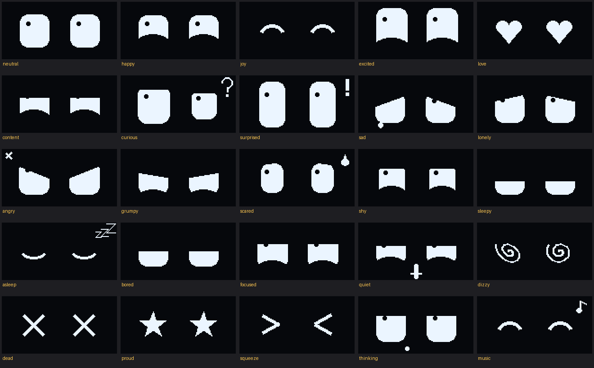

# Pinch 🦀: a pocket robot crab pet

A hand-sized robot crab (about 20 cm across, 10 cm tall, 0.61 kg) that feels like a pet. It has
moods and needs, and is a bit needy. It knows when you're in a meeting and goes quiet. It reacts to
touch and to your voice, does tricks, keeps its desk tidy and asks for help when it can't. Its
emotions show in its eyes on a small OLED face. It never talks: it chirps, purrs and trills.

Everything was designed, simulated, trained and tested in software before buying a single part. Ideas
are borrowed from KingKong's Jumper, MakeYourPet and Sesame ([docs/INSPIRATION.md](docs/INSPIRATION.md)).
Every part was in stock in India on 2026-11-19, about ₹91k plus prints ([hardware/BOM.md](hardware/BOM.md)).

**Start here:** [docs/MORNING_REPORT.md](docs/MORNING_REPORT.md) (status, what's verified, what's left)
and [docs/DECISIONS.md](docs/DECISIONS.md) (every decision and why).



## Play with Pinch on your laptop

```powershell
python -m venv .venv
.venv\Scripts\python -m pip install -r requirements.txt
.venv\Scripts\python -m pinch.app            # the virtual pet: 3D desk + Pinch's face, feelings, diary
.venv\Scripts\python -m pinch.app --llm      # also let the local LLM (Ollama) understand you
```

**Two windows open:**
- **3D desk:** Pinch on its desk with its live face. To pick it up or nudge it: double-click Pinch,
  then Ctrl + right-drag.
- **Panel:** its eyes, how it feels and what it needs, and a box to talk to it. Try "hi, I'm …",
  "dance", "play dead", "shake", "put the cap away", "I'm sad today", "I'm in a meeting". There are
  buttons for petting, stroking, tickling, booping and holding its claw; for messing up the desk,
  pushing the pen to the edge and starting a meeting; and **Listen**, which lets it hear you through
  your microphone (on-device only, never saved).

It remembers you between runs (`~/.pinch/memory.json`).

## What's inside

| Part | What | Where |
|---|---|---|
| Brain | Needs and emotions (needy by design), 17 activities picked by utility with commitment, memory, voice understanding (instant rules plus a local LLM), meeting detection from sound, touch gestures | [pinch/](pinch/) |
| Face | 25 animated expressions (Vector-style eyes, blinks, glyphs) on a 128×64 OLED | [pinch/face.py](pinch/face.py) |
| Digital twin | MuJoCo desk with edges, a desk tray with ArUco marker, a pen, eraser, cap and ball; cliff sensors; wide-angle eye camera; live face texture | [sim/desk.py](sim/desk.py), [pinch/twin/](pinch/twin/) |
| Motion | 21 emotes; scripted crawl/trot gait; learned walking and emote-balancing policies (Brax PPO on Modal, run as numpy) | [crab/](crab/), [training/](training/), [policies/](policies/) |
| Skills | Walk to a spot, turn, push things into the tray with a claw paddle (detours around obstacles), ask for help | [pinch/body.py](pinch/body.py) |
| Firmware | The robot's program (the same brain and body), drivers for the face, touch, cliff sensors, camera and mics, HTTP API, systemd service | [robot/pinch_main.py](robot/pinch_main.py), [deploy/](deploy/) |
| Hardware | 12 STS3032 leg servos, 6 GS-4308MG arm servos on the Radxa's PWM, Radxa ZERO 3W, 2.42" OLED face, MPR121 touch, two I2S mics, a 160° camera, 2S LiPo | [hardware/](hardware/) |
| CAD | 13 printable parts (27 pieces) including the face visor and the desk tray | [cad/](cad/), [cad/out/print/](cad/out/print) |

## Tests (all run in software)

```powershell
.venv\Scripts\python sim\pinch_scenarios.py     # Pinch's behaviour in the twin -> docs/BEHAVIOUR_TESTS.md
.venv\Scripts\python robot\firmware_test.py     # the robot's firmware on emulated hardware (8 checks)
.venv\Scripts\python sim\robustness.py          # trained vs scripted motion under randomised physics -> docs/ROBUSTNESS.md
.venv\Scripts\python robot\selftest.py          # servo bus, PWM, calibration, drivers, safety (32 checks)
.venv\Scripts\python sim\check.py               # standing load + all 21 emotes within servo limits
.venv\Scripts\python cad\check.py               # printability, servo fit, self-collision sweep (~25 min)
```

**Training** runs on a Modal GPU and is exported to numpy for the robot:

```powershell
$env:PINCH_GPU="A10G"; python -m modal run --detach training\modal_train.py::main --env walk --preset full --run walk-v3
python -m modal run training\modal_train.py::fetch --run walk-v3
.venv-rl\Scripts\python training\export_policy.py walk-v3 walk
```

## On the robot

Assembly and setup are in [hardware/ASSEMBLY.md](hardware/ASSEMBLY.md). Then:

```bash
sudo bash deploy/install.sh
```

Calibrate the servos with the firmware's Python
(`sudo /opt/pinch/venv/bin/python /opt/pinch/robot/calibrate.py`, saved to `/var/lib/pinch/calibration.json`;
the firmware won't start without it), then:

```bash
sudo systemctl start pinch
```

Talk to it from the laptop:

```bash
curl -X POST pinch.local:8080/say -d '{"text":"hi pinch"}'
```

The earlier, larger ST3215 design is archived in [variants/](variants/).
