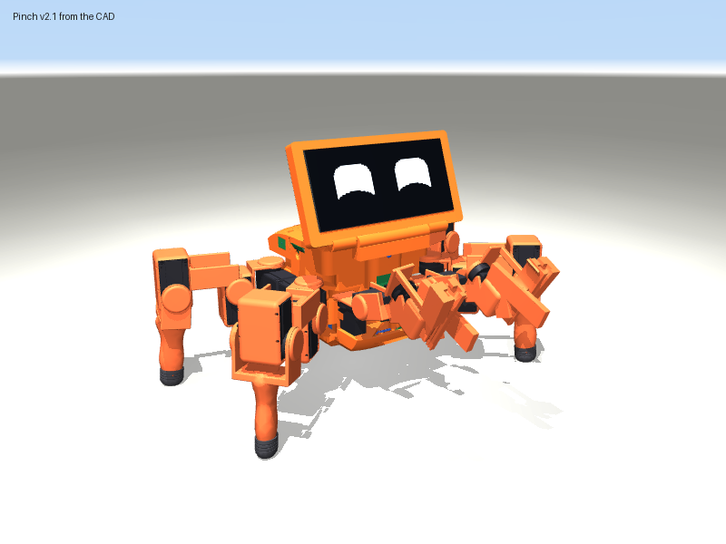
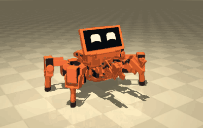
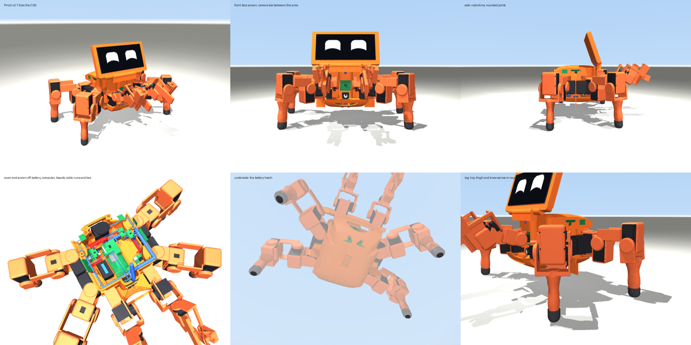

# Pinch 🦀: a robot crab pet

|  |  |
|---|---|

A small robot crab that feels like a pet: a pill-shaped shell about 17 cm across on four legs, two claws and a
6.25 inch face screen in a hinged lid, about 2.3 kg. It has moods and needs, reacts to touch and to your voice,
goes quiet when you're in a meeting and does tricks. It never talks: it chirps, purrs and trills.

It is being built in software first: the CAD, a MuJoCo twin generated from it, the pet's mind, learned motion and
the firmware that runs the same mind on the robot. The parts come to about ₹1 lakh from Indian stores
([hardware/BOM.md](hardware/BOM.md)).



## Try it on your laptop

```powershell
python -m venv .venv
.venv\Scripts\python -m pip install -r requirements.txt
.venv\Scripts\python -m pinch.app            # add --llm to let a local LLM (Ollama) understand you
```

Two windows open: a 3D desk with Pinch on it, and a panel with its face, how it feels and a box to talk to it.
Try "hi, I'm …", "dance", "play dead", "I'm sad today" or "I'm in a meeting", and the buttons for petting it.


## Where things are

| | |
|---|---|
| Mind: needs, emotions, attention, memory, voice, touch | [pinch/](pinch/) |
| Motion: gait, emotes, learned policies (Brax PPO on MJX) | [crab/](crab/), [training/](training/), [policies/](policies/) |
| Digital twin and benches | [sim/](sim/), [docs/dev/V2_MODEL.md](docs/dev/V2_MODEL.md) |
| Firmware | [robot/](robot/), [deploy/](deploy/) |
| CAD and parts | [cad/v2/](cad/v2/), [hardware/](hardware/) |

How it fits together is in [docs/ARCHITECTURE.md](docs/ARCHITECTURE.md), every decision and its measurements in
[docs/DECISIONS.md](docs/DECISIONS.md), and what it borrows from other robots in
[docs/INSPIRATION.md](docs/INSPIRATION.md).

## Developing

```powershell
.venv\Scripts\python -m ops check            # the guard, ruff and all tests: what CI runs
```

Workflows (tests, benches, training on any GPU, parallel work) are in [docs/dev/](docs/dev/); the rules for people
and coding agents are in [AGENTS.md](AGENTS.md).

## On the robot

```bash
sudo bash deploy/install.sh
sudo /opt/pinch/venv/bin/python /opt/pinch/robot/calibrate.py    # the firmware won't start without it
sudo systemctl start pinch
curl -X POST pinch.local:8080/say -d '{"text":"hi pinch"}'       # the other routes: robot/http_api.py
curl -X POST pinch.local:8080/stop                               # emergency stop (then /resume)
```
