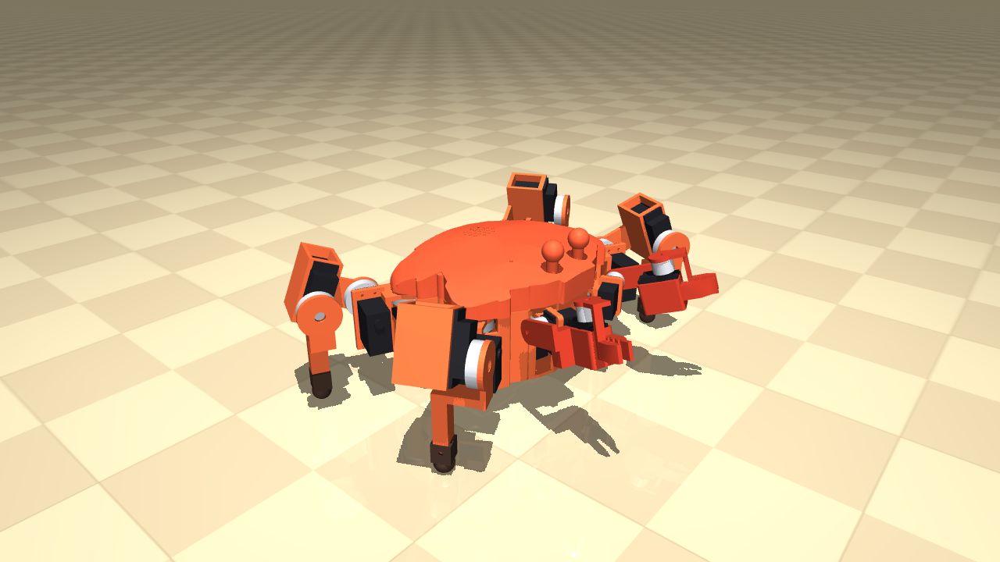
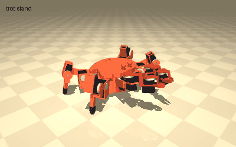

# Robotic Crab 🦀 (hand-sized)

A pocket-sized robot crab: 4 legs, 2 claws, 18 servos, a camera, ears, touch pads and a mind of its
own. It's about **20 cm across the feet, 9 cm tall and 0.61 kg**, with all wiring inside the body. It
was designed, simulated, tested and made order-ready entirely in open-source software, before buying a
single part. Inspired by Pollen Robotics' Open Duck Mini; feature ideas borrowed from KingKong's Jumper,
MakeYourPet and Sesame ([docs/INSPIRATION.md](docs/INSPIRATION.md)). Every part was in stock on
2026-11-18: Evelta (main store), robu.in (prints and a few parts), Amazon.in (four small items).



## Status: order-ready (Phase A done)

| | What | Where | Verified by |
|---|---|---|---|
| ✅ | Parametric robot: every dimension and servo in one file | [crab/params.py](crab/params.py) | |
| ✅ | **Per-servo motor models**: STS3032 bus servos (legs), GS-4308MG micro PWM servos (arms); torque-speed, back-EMF, friction, rotor inertia, backlash, latency | [crab/params.py](crab/params.py), [sim/servo_check.py](sim/servo_check.py) | thermal (RMS vs rated torque) and drive-limit checks in every test |
| ✅ | 6 emotes: idle, wave, angry, happy, shy, sleep | [crab/emotes.py](crab/emotes.py) | `sim/check.py`: all within servo limits, warmest servo 35% of rated |
| ✅ | Scripted walking: trot (everyday) and crawl (sneak), any direction | [crab/gait.py](crab/gait.py) | `sim/walk.py`: 6 directions × 2 gaits pass (82–96% speed tracking) |
| ✅ | **Full CAD**: 12 printable parts (26 pieces), STL + STEP, enclosed body with battery bay, belly door, brain tray, camera pocket, speaker grille, 3-joint claw arms on 4.3 g servos | [cad/](cad/), [cad/out/print/](cad/out/print) | `cad/check.py`: walls ≥ 1.6 mm, every servo fits, self-collision sweep over stand, emotes, gaits and joint limits |
| ✅ | Simulator built from the CAD (meshes, real masses and inertia: 0.61 kg) | [sim/build_model.py](sim/build_model.py) | |
| ✅ | Joint limits from CAD interference (bisection), a shin-vs-hip coupled limit, and an arm-collision guard | [cad/limits.py](cad/limits.py), [crab/kinematics.py](crab/kinematics.py) | self-test: arms can't touch anywhere in their ranges |
| ✅ | Electronics: block diagram, [wiring drawing](hardware/wiring.svg), Radxa pin map, simulated power budget (~35 min per charge), safety | [hardware/electronics.md](hardware/electronics.md) | `sim/power.py` |
| ✅ | Robot runtime for the Radxa ZERO 3W: own Feetech driver, arm servos on the Radxa's hardware PWM, calibration (legs measured, arms trimmed by eye), safety, emotes, gait, policy, hardware check | [robot/](robot/) | `robot/selftest.py`: **32/32** against a byte-level emulated servo bus, emulated PWM and MuJoCo |
| ✅ | RL training pipeline (MJX + Brax PPO) and Colab notebook | [training/](training/) | CPU smoke test trains, saves, and the policy runs through `sim/walk.py --policy` |
| ✅ | **Pet mind**: reflexes + drives (curiosity, boredom, energy, loneliness, fear) + Gemma 4 as a slow advisor; tones only, it never talks | [brain/](brain/), [docs/PET_MIND.md](docs/PET_MIND.md) | `brain/run_pet.py`: 3-minute simulated day ([timeline](docs/images/pet_timeline.png)) |
| ✅ | **The order**: Evelta + robu + Amazon.in, ₹85k incl. GST + prints, everything in stock | [hardware/BOM.md](hardware/BOM.md) | prices and stock checked 2026-11-18 |
| ✅ | Beginner assembly guide | [hardware/ASSEMBLY.md](hardware/ASSEMBLY.md) | |
| ⏳ | Electronics layout fitted in the CAD (board positions are still estimates) | [docs/ROADMAP.md](docs/ROADMAP.md) | |
| ⏳ | GPU training run (Colab), then the physical build | [docs/ROADMAP.md](docs/ROADMAP.md) | |



## Quick start (Windows, PowerShell)

```powershell
python -m venv .venv
.venv\Scripts\python -m pip install -r requirements.txt
.venv\Scripts\python cad\build.py            # CAD -> print STLs, sim meshes, masses, collision boxes
.venv\Scripts\python sim\build_model.py      # params + CAD -> sim/models/crab.xml
.venv\Scripts\python sim\walk.py --view      # watch it walk (forward, crab-walk, turn)
.venv\Scripts\python sim\view.py             # watch the emotes
.venv\Scripts\python brain\run_pet.py --view # watch it live for 3 minutes with its pet mind
.venv\Scripts\python robot\run.py --sim      # the robot program, driving the simulator
```

Tests:

```powershell
.venv\Scripts\python sim\check.py            # stand + emotes vs servo limits (+ renders)
.venv\Scripts\python sim\walk.py             # walking, both gaits, all directions
.venv\Scripts\python cad\check.py            # print rules, servo fit, self-collision sweep (~25 min)
.venv\Scripts\python robot\selftest.py       # robot software against simulated hardware
.venv\Scripts\python robot\calibrate.py --sim   # rehearse the three calibration steps
.venv\Scripts\python sim\power.py            # current draw and battery runtime
```

RL (separate environment, pinned versions):

```powershell
python -m venv .venv-rl
.venv-rl\Scripts\python -m pip install -r requirements-train.txt
.venv-rl\Scripts\python training\train.py --preset smoke     # proves the pipeline on CPU
.venv\Scripts\python training\make_colab_bundle.py          # then train for real in training/colab_train.ipynb
```

## How the pieces fit

```
crab/params.py ──► cad/ (build123d) ──► STL/STEP for printing
      │                 │
      │                 └──► meshes + masses ──► sim/models/crab.xml (MuJoCo)
      │                                              │
      ├──► crab/kinematics, gait, emotes ────────────┤──► sim tests, viewer, GIFs
      ├──► crab/policy_io (obs/action contract) ─────┤──► training/ (MJX + PPO, Colab)
      └──► robot/ (Radxa ZERO 3W runtime) ◄──────────┘    brain/ (pet mind + Gemma 4 via Ollama)
              ├─ RealBackend: own Feetech driver + FE-URT-1 (legs), hardware PWM (arms), BNO055, INA219
              └─ SimBackend / emulated bus + PWM: the same code, driving MuJoCo
```

## Design decisions the simulator and CAD forced

* **Only in-stock parts:** the first design's HD-1910 / SCS0009 servos and the Pi Zero 2 W were sold
  out everywhere, so the crab was redesigned around what Indian stores had: STS3032 bus servos for the
  legs, GOTECK GS-4308MG micro servos for the arms, and a Radxa ZERO 3W (same size as a Pi Zero).
* **Tiny arm motors:** with a 20 g STS3032 in each arm joint, the arms pulled the centre of mass 22 mm
  forward and the front thighs ran at 82% of rated torque just standing. 5.8 g servos in 3-joint arms
  (swing, lift, claw, with the claw servo's shaft as the finger hinge) brought that down to 33%.
* **Shins near vertical when standing:** less lever on the thighs.
* **Arm servos on the Radxa's own PWM pins:** the six outputs don't clash with the audio, I2C or GPIO
  pins, so no PWM board is needed (none would fit in the body anyway). The servos can't report where
  they are, so a by-eye trim tool lines them up and measures their travel (their listing is ambiguous).
* **A coupled shin limit:** the CAD sweep found the shin brushing the hip link in the sideways crawl
  when folded back past 125°, so thigh + shin angle is limited to −122° in the gait maths and in the
  robot's safety layer. Walking performance didn't change.
* **5 V servo bus:** the only compact, in-stock regulator is a fixed 5 V / 5 A buck; the simulator uses
  every servo's datasheet scaled to 5 V.
* **The arms point further forward** (15°) to clear the front legs; a box-based guard stops the arms
  before they touch each other.
* **Battery:** the in-stock 2S pack is 57 × 30 mm, so it lies across the body under the deck, with a
  belly door. An INA219 measures the real pack voltage, since the servos sit behind the regulator.
* **Pet behaviour:** an LLM alone isn't proactive, and takes 18–37 s per decision on a CPU. Curiosity comes
  from drives, and Gemma only advises ([docs/PET_MIND.md](docs/PET_MIND.md)).

## Known limitations

* **Servo models are datasheet-based**: no published measurements exist for the STS3032 or GS-4308MG.
  RL randomises motor strength widely; measure the real servos in Phase C and update `crab/params.py`.
  The published *measured* model (Rhoban BAM, ST3215) is kept in `crab/params.py`.
* **The GS-4308MG's dimensions are estimated** from its listing and photos. Measure one with the
  calliper before printing (ASSEMBLY.md, stage 0).
* **Electronics layout:** the boards' positions inside the body are estimates for the mass model; they
  haven't been fitted in the CAD yet. The space between the deck servos is tight.
* **The Radxa audio overlay** (`hardware/radxa/crab-audio.dts`) is adapted from Radxa's own overlay for
  the same amp but hasn't been tried on a ZERO 3W.
* `RealBackend`, the I2C drivers, the Radxa PWM driver and `setup_servo.py` couldn't be run without
  hardware. They're tested against byte-level emulations (servo bus, PWM chip registers, Linux sysfs).
* Self-collision is off in the physics sim. It's covered by the CAD sweep, the CAD-derived joint limits
  and the arm guard.
* On the real robot the pet mind still needs its senses layer (camera, mic, touch → events), Phase C5.
* The brain needs Ollama with `gemma4:e4b` (≈ 6.6 GB) on the PC. Tested against the simulator: one
  decision per 18–37 s on a laptop CPU.

The earlier, larger ST3215 design (2 kg, 35 cm) is archived in [variants/](variants/).
