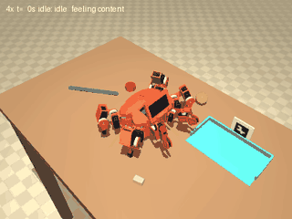
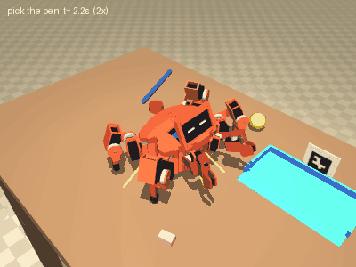
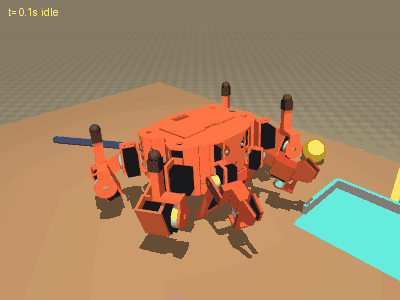
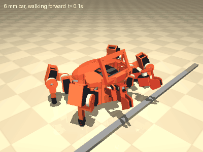

# Pinch 🦀: a pocket robot crab pet

A hand-sized robot crab (about 20 cm across, 10 cm tall, 0.61 kg) that feels like a pet. It has
moods and needs, and is a bit needy. It knows when you're in a meeting and goes quiet. It reacts to
touch and to your voice, does tricks, keeps its desk tidy and asks for help when it can't. Its
emotions show in its eyes on a small OLED face. It never talks: it chirps, purrs and trills.

Everything was designed, simulated, trained and tested in software before buying a single part. Ideas
are borrowed from KingKong's Jumper, MakeYourPet and Sesame ([docs/INSPIRATION.md](docs/INSPIRATION.md)).
Every part was in stock in India on 2026-11-19, about ₹91k plus prints ([hardware/BOM.md](hardware/BOM.md)).

## In simulation

| | |
|---|---|
|  |  |
| **A minute of pet life** (4× speed): it wanders, notices things, reacts | **Tidying:** picks up a pen and drops it in the desk tray |
|  |  |
| **Gets up off its back** with a learned policy (about half a second) | **Walks over obstacles:** a 6 mm bar, head-on |


## What's verified (in simulation)

| Area | Result | Evidence |
|---|---|---|
| Walking | Learned corrections on a scripted trot: **0 falls** in 200 randomised episodes over five worlds (flat, rough, caught foot, hurdles, steeper hurdles), 80–86 % speed tracking (scripted alone: 65–69 %) | [docs/ROBUSTNESS.md](docs/ROBUSTNESS.md) and the `ROBUSTNESS_*` reports |
| Obstacles | Cables, pens and a book, forward and sideways; bars and ramps in [docs/HURDLES.md](docs/HURDLES.md) | `sim/benches/obstacles.py`, `sim/benches/hurdles.py` |
| Getting up | **200/200** random falls on its back, 0.54 s on average (the searched swing it replaced: 107/200) | `sim/benches/righting.py` |
| Emotes | 22 emotes with a learned balance policy, 0 falls | [docs/ROBUSTNESS.md](docs/ROBUSTNESS.md) |
| Behaviour | 12 of 13 scenarios, from tricks and learning your name to comforting you and raising the alarm when something nears the edge | [docs/BEHAVIOUR_TESTS.md](docs/BEHAVIOUR_TESTS.md) |
| Tidying | Still the weakest skill: on a 24-layout bench the cap reaches the tray 11/24 times and the eraser 11/24, and the toy ball gets knocked off in about half the runs | `sim/benches/tidy.py` |
| Firmware | 47/47 checks on emulated hardware, 40/40 selftest; the control tick fits the robot's CPU budget | `robot/firmware_test.py`, `robot/selftest.py` |
| Code | 35+ tests: exact replay, a golden trace for refactors, fault injection, fuzzed servo safety, layering rules, the operations layer; ruff and a private-file guard on every commit and in CI | `python -m ops check` |

Every design decision and the measurements behind it are in [docs/DECISIONS.md](docs/DECISIONS.md); the
research behind the approach is in [docs/APPROACH_PLAN.md](docs/APPROACH_PLAN.md).

## Play with Pinch on your laptop

```powershell
python -m venv .venv
.venv\Scripts\python -m pip install -r requirements.txt
.venv\Scripts\python -m pinch.app            # the virtual pet: 3D desk + Pinch's face, feelings, diary
.venv\Scripts\python -m pinch.app --llm      # also let the local LLM (Ollama) understand you
```

**Two windows open:**
- **3D desk:** Pinch on its desk with its live face. To pick it up or nudge it: double-click Pinch,
  then Ctrl + right-drag.
- **Panel:** its eyes, how it feels and what it needs, and a box to talk to it. Try "hi, I'm …",
  "dance", "play dead", "shake", "put the cap away", "I'm sad today", "I'm in a meeting", "quiet hours
  from 10 pm to 7 am". There are buttons for petting, stroking, tickling, booping and holding its claw;
  for messing up the desk, pushing the pen to the edge and starting a meeting; and **Listen**, which lets
  it hear you through your microphone (on-device only, never saved).

It remembers you between runs (`~/.pinch/memory.json`).

## What's inside

| Part | What | Where |
|---|---|---|
| Mind | Needs and emotions (needy by design), 24 activities chosen by utility with commitment, attention, memory, a daily routine with quiet hours, voice understanding (instant rules plus a local LLM), meeting detection from sound, touch gestures, faces | [pinch/](pinch/) |
| Body | Walking and turning with an edge guard, pushing things with a claw paddle, picking and dropping, idle life (breathing, fidgets), getting up | [pinch/body/](pinch/body/) |
| Face | 25 animated expressions (Vector-style eyes, blinks, glyphs) on a 128×64 OLED | [pinch/face.py](pinch/face.py) |
| Digital twin | MuJoCo desk with edges, a desk tray with ArUco marker, a pen, eraser, cap and ball; cliff sensors; wide-angle eye camera; live face texture; fault injection | [sim/desk.py](sim/desk.py), [pinch/twin/](pinch/twin/) |
| Motion | 22 emotes; scripted trot; learned walking, emote-balance and get-up policies (Brax PPO on MJX, run on the robot as plain numpy) | [crab/](crab/), [training/](training/), [policies/](policies/) |
| Firmware | The robot's program (the same mind and body), drivers for the face, touch, cliff sensors, camera and mics, an HTTP API, a systemd service | [robot/firmware/](robot/firmware/), [deploy/](deploy/) |
| Hardware | 12 STS3032 leg servos, 6 GS-4308MG arm servos on the Radxa's PWM, Radxa ZERO 3W, 2.42" OLED face, MPR121 touch, two I2S mics, a 160° camera, 2S LiPo | [hardware/](hardware/) |
| CAD | 14 printable parts (31 pieces) including the face visor and the desk tray; 241/241 poses collision-free | [cad/](cad/), [cad/out/print/](cad/out/print) |

## Tests and benches

```powershell
.venv\Scripts\python tests\run.py                     # the test suite
.venv\Scripts\python robot\firmware_test.py           # the firmware on emulated hardware
.venv\Scripts\python robot\selftest.py                # servo bus, PWM, calibration, drivers, safety
.venv\Scripts\python sim\benches\scenarios.py         # behaviour in the twin -> docs/BEHAVIOUR_TESTS.md
.venv\Scripts\python sim\benches\robustness.py        # trained vs scripted motion -> docs/ROBUSTNESS.md
.venv\Scripts\python sim\benches\hurdles.py           # bars and ramps -> docs/HURDLES.md
.venv\Scripts\python sim\clips.py                     # these GIFs, freshly rendered -> media/
.venv\Scripts\python cad\check.py                     # printability, servo fit, self-collision sweep (~25 min)
```

The other benches (tidy, pick, righting, soak, obstacles) are in [sim/benches/](sim/benches/); each takes
`--json` to save its results.

**Training** runs on any GPU through one command: this laptop, machines on a Tailscale network (Linux or
Windows/WSL), Modal or SkyPilot clouds. Experiments are files in `configs/experiments/`, and every run records its
commit. Results are exported to numpy for the robot:

```powershell
.venv\Scripts\python -m ops submit configs\experiments\righting.toml --host any --cloud-fallback
.venv\Scripts\python -m ops jobs -r                                 # what is training where
.venv\Scripts\python -m ops fetch righting                          # checkpoint -> training\checkpoints\
.venv\Scripts\python -m ops export righting righting_v2             # -> policies\righting_v2.npz
.venv\Scripts\python -m ops eval configs\experiments\righting.toml righting_v2   # the experiment's benches
```

## Developing

The layout, layers, training pipeline and compute are described in [docs/ARCHITECTURE.md](docs/ARCHITECTURE.md);
the workflows in [docs/dev/](docs/dev/). `python -m ops check` runs everything CI runs (private-file guard, ruff,
tests). Several agents can work at once, each in its own worktree (`python -m ops worktree new <task>`), and
[AGENTS.md](AGENTS.md) holds the rules they follow.

## On the robot

Assembly and setup are in [hardware/ASSEMBLY.md](hardware/ASSEMBLY.md). Then:

```bash
sudo bash deploy/install.sh
```

Calibrate the servos with the firmware's Python
(`sudo /opt/pinch/venv/bin/python /opt/pinch/robot/calibrate.py`, saved to `/var/lib/pinch/calibration.json`;
the firmware won't start without it), then:

```bash
sudo systemctl start pinch
```

Talk to it and control it from the laptop (HTTP on port 8080):

```bash
curl -X POST pinch.local:8080/say -d '{"text":"hi pinch"}'
curl pinch.local:8080/status                                         # how it feels, what it's doing
curl pinch.local:8080/memory                                         # what it remembers about you
curl -X POST pinch.local:8080/forget -d '{"what":"people"}'          # forget faces and people (or "everything")
curl -X POST pinch.local:8080/settings -d '{"face_recognition":false}'
curl -X POST pinch.local:8080/quiet_hours -d '{"start":22,"end":7}'
curl -X POST pinch.local:8080/stop                                   # emergency stop (then /resume)
```
