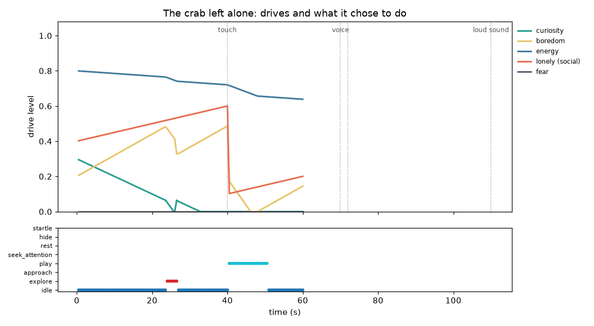

# The pet mind: why the crab does things on its own

**The question:** will running Gemma 4 make the crab curious and proactive?

**Answer: not by itself.** A language model only answers when you ask it something. On a laptop CPU it
takes **18–37 s per decision** (measured with `gemma4:e4b` here). A pet that freezes for half a minute,
and does nothing unless prompted, doesn't feel alive. Curiosity and proactiveness come from **drives**:
inner needs that grow by themselves and push the crab into action. Gemma is useful for something else:
*understanding* what it sees and hears, and adding variety. So the crab has three layers.

| Layer | Runs | Does | File |
|---|---|---|---|
| **Reflexes** | every 20 ms | breathing, claw fidgets, flinching, cliff stop, the arm guard | `brain/pet_mind.py` `Reflexes`, `robot/crab_robot.py` |
| **Heart** | about once a second | drives → chooses a behaviour | `brain/pet_mind.py` `Heart` |
| **Mind** | every 30–60 s, in the background | Gemma looks at the camera, hears speech, *suggests* a behaviour and a sound | `brain/pet_mind.py` `Mind`, `brain/brain.py` |

The mind only ever **biases** the heart (a +0.35 nudge for 20 s). It never blocks it, so the crab keeps
living while Gemma thinks.

## Drives

| Drive | Grows when | Falls when |
|---|---|---|
| curiosity | something new appears (camera novelty), a voice, a face | it explores or approaches (curiosity satisfied) |
| boredom | it idles or rests | it does anything active |
| energy | it rests | it walks or plays (tiredness) |
| social ("lonely") | time passes alone | it's petted or spoken to |
| fear | a loud bang, being lifted | slowly, on its own |
| mood | petting, company | fear, loneliness |

Each behaviour has a **utility** computed from the drives:
- *explore* needs real curiosity or boredom
- *seek attention* needs loneliness
- *rest* comes with low energy
- *hide* and *startle* come with fear

The highest utility wins. A small bonus for the current behaviour stops it flip-flopping.

What happens in the world also gives a short, strong **urge**:
- being petted → a happy wiggle
- being spoken to → it walks over to look

**Habituation:**
- something new only counts once every 6 s
- what it sees while walking counts much less (it's mostly its own doing)
- only *really* new things beat boredom

Without this, the camera's own motion kept the crab curious forever, so it explored nonstop. That's
fixed now.

## What it looks like

`python brain/run_pet.py` lets the crab live for 3 minutes in the simulator. It gets petted at 40 s,
a person says hello at 70 s, and a loud bang happens at 110 s. Otherwise nobody does anything.

In that run it idles most of the time, as pets do. When bored it sets off exploring by itself
(around 23 s and again around 164 s). It wiggles happily when petted, walks over when spoken to,
startles and hides after the bang, rests, then goes back to idling. About 9 behaviour changes start
without any event nearby.

## It never talks

The crab only makes **tones**, synthesised on the Pi (`brain/sounds.py`):
- greeting beep
- curious chirp
- happy trill
- sleepy hum
- startled squeak
- angry buzz
- sad tone

Gemma's answer has a `sound` field restricted to these names (structured JSON output). Anything else is
dropped by `sanitize()`. The microphone listens: for loud sounds, and for speech once a speech-to-text
model is added (see the roadmap).

## Tuning

Every number lives in `brain/pet_mind.py` (`Heart.feel`, `Heart.utilities`, `Heart.tick`):
- **more adventurous:** raise the boredom rate in `tick`, or lower the 0.2 offset in the explore utility
- **lazier:** raise the idle base (0.30)
- **clingier:** raise the social rate

Run `python brain/run_pet.py` after a change and look at `docs/images/pet_timeline.png`.

## Running it

| Where | Command |
|---|---|
| Simulator, stand-in mind (no model needed) | `python brain/run_pet.py` |
| Simulator, Gemma on this PC | `ollama pull gemma4:e4b`, then `python brain/run_pet.py --gemma` |
| Simulator, Gemma on another PC | `python brain/run_pet.py --gemma --host http://<pc-ip>:11434` |

**On the real crab** the same heart and mind run unchanged. What's still to write is the small *senses*
layer: it turns the camera, microphone, touch pads, distance sensors and IMU into `Event`s, replacing the
scripted `WORLD` list in `run_pet.py`. It's the first item of Phase C in [ROADMAP.md](ROADMAP.md), done
once the hardware is on the desk, because each sensor's thresholds need real readings.
