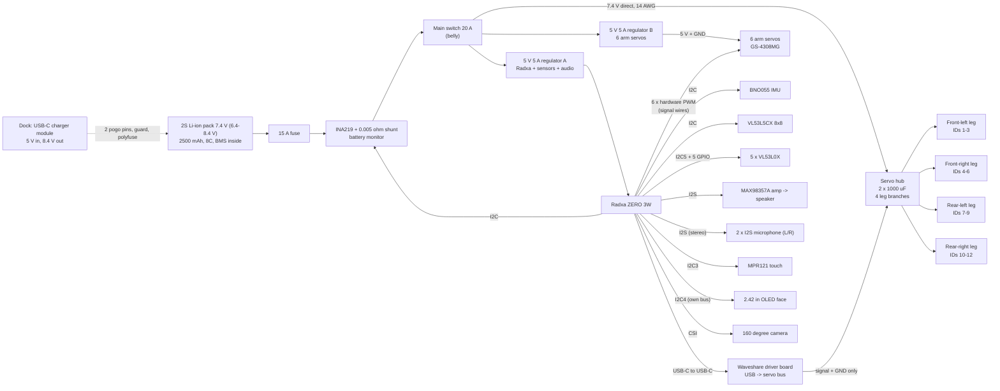

# Electronics design (Pinch, 12 x STS3215 legs)

> **Changed 2026-11-21.** The legs are now 12 Feetech/Waveshare STS3215 7.4 V servos that run **straight from a 2S Li-ion
> pack**, not from a 5 V regulator. The reasons, sources and open questions are in
> [../docs/research/BOM_CHANGE.md](../docs/research/BOM_CHANGE.md). Currents below are **estimates until measured**; the
> stall figure is the seller's. The wiring drawing (`wiring.svg`) and `ASSEMBLY.md` still show the old 5 V servo rail
> and have not been redrawn yet.

Every board lives inside the body. Parts and prices are in [BOM.md](BOM.md). Where things sit is defined by the CAD
(`cad/parts.py`); **the CAD is being redesigned for a bigger robot (about 30 cm), so this table is the intent, not the old
pocket sizes.**

| Place | What |
|---|---|
| **Battery bay** (under the servo deck, belly door) | 2S1P 18650 Li-ion pack with its BMS (Samsung 25R, 7.4 V 2500 mAh) |
| **Deck** (between the yaw servos) | Waveshare bus servo driver board, servo hub (12 bus + 6 arm headers, 2 x 1000 uF), fuse, BNO055 IMU |
| **Under the brain tray** | Two 5 V 5 A regulators, INA219 battery monitor |
| **Belly** | Main power switch (20 A rocker), XT60 battery socket |
| **Brain tray** (under the dome) | Radxa ZERO 3W, MAX98357A amp, two I2S microphones, MPR121 touch board |
| **Front wall** | 160 degree camera, VL53L5CX 8x8 distance sensor |
| **Face visor** | 2.42" OLED face (SSD1309) |
| **Chassis walls** | Five VL53L0X cliff sensors |
| **Dock contacts** (back or belly, CAD to decide) | 2 pogo pins, reverse guard, polyfuse, NTC |

## Block diagram

## Why it's built this way

- **Legs run straight from the pack (6.4-8.4 V), no regulator.** Open Duck Mini (4,763 stars) powers 14 STS3215
  from a 2 x 18650 series pack through a BMS and a switch, with only a 5 V regulator for the computer. Rhoban/bam's fitted
  model and Pollen's training both treat battery voltage and sag as part of the motor model (Pollen randomises 6.5-8.2 V).
  A regulator for the legs would need to carry 10 A or more. **Open question:** Waveshare and DFRobot list the 7.4 V
  servo as 4-7.4 V, and a full pack is 8.4 V (other sellers list 6-8.4 V). Test one servo at 8.4 V for an hour first
  (BOM_CHANGE.md, question 1).
- **Two 5 V regulators, neither feeds the legs.** The old single regulator was too small for the legs' peaks. Regulator A
  feeds the Radxa, sensors and audio, so servo spikes cannot reset the computer. Regulator B feeds the six arm servos
  (GS-4308MG, rated 4.8-6 V).
- **Pack protection.** The pack's BMS cuts off at its own low-voltage level, so a deep discharge cannot ruin the cells.
  The 15 A fuse sits directly after the battery; the XT60 plug cannot go in backwards.
- **Fuse: 15 A.** Each STS3215 stalls at 2.5 A at 7.4 V (DFRobot, Waveshare listings), so 12 stalled servos would be
  30 A, which cannot happen (a leg stalls only briefly, and the servo has its own overload protection). I assume up to
  4 servos pulling hard at once, about 10 A (ESTIMATE). 15 A holds that and still protects the 14 AWG trunk and the pack
  (the seller rates it 20 A continuous).
- **Power doesn't go through the signal adapter.** The driver board only converts the signal (USB to the one-wire servo
  bus). Servo power goes from the switch into the hub. On the bench, the board's DC jack can feed servos directly.
- **Bulk capacitors.** 1000 uF at the hub (two) and on each 5 V regulator input (one each) soak up the current spikes.
- **A battery monitor with a real shunt.** The INA219 breakout's 0.1 ohm shunt clips at 3.2 A, so it is replaced by a
  0.005 ohm resistor (reads up to 64 A, drops 50 mV at 10 A). The INA219 reads the pack voltage over I2C. The software
  stop must stay above what the 5 V regulators need (see BOM_CHANGE.md, risk 3).
- **Arm servos straight on the Radxa's PWM pins** (unchanged): six hardware PWM outputs, power from regulator B.
- **One bus for the legs.** All 12 leg servos speak Feetech's STS protocol (4096 steps per turn) on one bus, 1 Mbps.
- **Charging dock (new).** The charger lives in the dock (USB-C 5 V in, boosted to 8.4 V 2 A), and two spring pins on the
  robot carry the charge into the pack through the BMS. Needs a reverse guard and a polyfuse on the robot side. Not built
  yet: test with a dummy weight first (docs/research/audit/ext_runtime_power.md section 12).

## Power budget (ESTIMATES, to be measured on the bench)

Seller figures: stall 2.5 A at 7.4 V, no load 150 mA (Waveshare). Standing torque is about 6 % of stall at a joint
(about 1.1 kg.cm of 19.5, docs/research/SERVO_CHOICE.md). Radxa + camera + sensors 4 W is an old assumption, unmeasured.

| Activity | Servo current avg / peak (7.4 V) | Pack current (incl. 5 V rails) | Runtime, 2500 mAh x 80 % |
|---|---|---|---|
| Standing, torque on | 2-3 A / 4 A | about 3.2 A | about 37 min |
| Walking | about 4 A / 10 A | about 4.8 A | about 25 min |
| Peak (fall, short stalls) | 10 A | 11 A | under 1 s |

Regulators carry only the 5 V side: A about 1 A, B up to 3 A (6 arm servos, ESTIMATE). Battery side: 2500 mAh x 7.4 V =
18.5 Wh. The old table (from `python sim/power.py`) described the STS3032 at 5 V and is no longer valid; `sim/power.py` is
out of this task's scope and still models the old servo.

## Wiring table

| From | To | Wire / connector | Notes |
|---|---|---|---|
| Battery pack | XT60 male pigtail | 14 AWG | Red = +, black = - |
| XT60 female (robot) | Fuse holder | 14 AWG | **15 A** ATC fuse |
| Fuse | INA219 VIN+ | 14 AWG | Shunt is the 0.005 ohm resistor; GND goes straight through |
| INA219 VIN- | Main switch | 14 AWG | |
| INA219 VCC / GND / SDA / SCL | Radxa pins 1 / 9 / 3 / 5 (shared I2C) | 28 AWG | I2C address 0x40 |
| Switch | Servo hub V+ / GND | 14 AWG trunk | **Straight 7.4 V (6.4-8.4 V). Two 1000 uF caps across the hub** |
| Switch | Regulator A VIN / GND | 20 AWG | 1000 uF across VIN |
| Switch | Regulator B VIN / GND | 20 AWG | 1000 uF across VIN |
| Regulator A VOUT / GND | Radxa pin 2 (5 V) / pin 6 (GND), amp and sensors | 22 AWG | **Measure 4.9-5.2 V first, with nothing connected, also with the input at 6.0 V** |
| Regulator B VOUT / GND | Hub arm-servo V+ and GND (separate from the leg V+) | 20 AWG | Measure 4.9-5.2 V first. Do not join this rail to the leg rail |
| Waveshare driver board servo port | Servo hub **signal + GND only** | Servo cable | Do not connect the board's DC jack in the robot |
| Driver board USB-C | Radxa USB-C host port | short USB-C to USB-C data cable | Shows up as `/dev/ttyACM0` or `/dev/ttyUSB0` (check which); 1 Mbps |
| Arm servo plugs (6) | Hub: V+ and GND from regulator B; **signal** pin of each plug to the Radxa header pin below | F-F jumper wires for the signals | Order of plugs = PWM output 0-5 |
| BNO055 | Radxa pin 1 (3.3 V), 3 (SDA), 5 (SCL), 9 (GND) | 28 AWG | I2C address 0x28 |
| VL53L5CX | 3.3 V, GND, SDA, SCL on its own I2C bus (decide in the new CAD; address 0x29) | 28 AWG | Same address as the VL53L0X cliff sensors' default (0x29): keep it off their bus |
| VL53L0X x 5 | Own bus I2C5-M0 (pins 29/31); XSHUT: front left 11, front right 13, rear 15, side left 22, side right 36 | 28 AWG | All start at 0x29; the software gives them 0x30-0x33 |
| MAX98357A | 5 V (pin 4), GND (pin 14), BCLK pin 12, LRC pin 35, DIN pin 40 | 28 AWG | Speaker on its + / - terminals |
| I2S microphones x 2 | both: 3.3 V (pin 17), GND (pin 20), SCK pin 12, WS pin 35, SD pin 38. Left mic SEL to GND, right to 3.3 V | 28 AWG | One stereo stream |
| MPR121 touch | 3.3 V, GND, SDA pin 3, SCL pin 5 (I2C3), address 0x5A | 28 AWG | Electrodes E0-E7 as before |
| Face OLED (SSD1309) | 3.3 V, GND, SDA pin 27, SCL pin 28 (I2C4), address 0x3C | 28 AWG | Set to I2C; reset RC as before |
| Camera (160 degrees, OV5647) | Radxa camera connector (22-pin) | Its own flex | Measure its lens board first |
| Dock pogo pins (2) | Reverse guard, polyfuse, then pack charge lead (P+/P- side of the BMS) | 22 AWG | Contacts are dead until the robot is sensed; NTC on the pack |

### Arm servo signals (Radxa hardware PWM)

| PWM output | Joint | Radxa header pin | PWM channel (rsetup overlay) |
|---|---|---|---|
| 0 | L_shoulder_yaw (left arm swing) | 16 | PWM8-M0 |
| 1 | L_shoulder_pitch (left arm lift) | 18 | PWM9-M0 |
| 2 | L_claw | 21 | PWM12-M1 |
| 3 | R_shoulder_yaw | 24 | PWM13-M1 |
| 4 | R_shoulder_pitch | 7 | PWM14-M0 |
| 5 | R_claw | 19 | PWM15-M1 |

Enable the six overlays in `sudo rsetup` -> Overlays, then reboot. `python robot/run.py --check` lists any output it
can't find by its header pin.

Inside each leg the servos daisy-chain with the cables that come with them: hub -> yaw -> thigh -> knee. The leg
current of all three servos flows through the first servo's cable (up to about 7.5 A if all three stalled): keep the
runs short, and feed each leg from its own hub branch. The arm servos don't chain.

## Servo ID map (matches `crab/params.py` JOINT_NAMES order)

| ID | Joint | Servo | ID | Joint | Servo |
|---|---|---|---|---|---|
| 1 | FL_coxa | STS3215 | 7 | RL_coxa | STS3215 |
| 2 | FL_femur | STS3215 | 8 | RL_femur | STS3215 |
| 3 | FL_tibia | STS3215 | 9 | RL_tibia | STS3215 |
| 4 | FR_coxa | STS3215 | 10 | RR_coxa | STS3215 |
| 5 | FR_femur | STS3215 | 11 | RR_femur | STS3215 |
| 6 | FR_tibia | STS3215 | 12 | RR_tibia | STS3215 |

IDs 13-18 are the arm servos in the software's joint list, but they have no bus ID: they are PWM outputs 0-5.

New bus servos all ship as **ID 1**. `robot/setup_servo.py --id N` assigns IDs one servo at a time. Put a small sticker
with the ID on each servo.

## Servo settings written by the setup script (to confirm on the bench; `robot/setup_servo.py` still has the old values)

| Register | Value | Why |
|---|---|---|
| P / I / D gains | 32 / 0 / 0 | Feetech default; the public BAM fit assumed kp 32 |
| Max input voltage | about 86 (8.6 V) | Above a full pack (8.4 V), so the servo trips only on a real over-voltage. Check the register units on the bench |
| Min input voltage | about 55 (5.5 V) | Stops only on a real sag |
| Return delay | 0 | Faster bus |

## Safety rules (read before first power-up)

1. **First power-up through the 15 A fuse, servos unplugged.** Then plug in one leg servo at a time, then a leg.
2. **Check polarity with the multimeter** at every connector before plugging anything in. The XT60 only fits one way,
   the DC plug cable does not care: check the centre pin is +.
3. Measure both 5 V regulators (**4.9-5.2 V**) with nothing connected.
4. Charge the pack **in the LiPo bag, in a fire-safe place, never unattended**, with the 8.4 V charger (it charges
   through the pack's main lead; the BMS balances the two cells). Never charge a pack that is warm, dented or puffy.
5. The software warns and stops at pack-voltage levels it was given for the old 2S LiPo (6.8 V and 6.4 V): these must be
   re-set after the 5 V regulator test (BOM_CHANGE.md, risk 3).
6. If a battery is **puffy, dented or hot**, stop using it and take it to an e-waste point.
