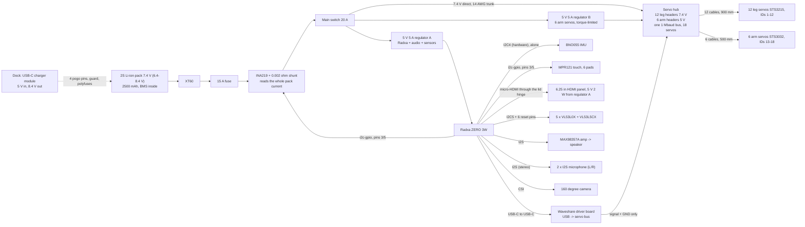

# Electronics design (Pinch v2 style B: 12 x STS3215 legs, 6 x STS3032 arms, HDMI face)

> **Agrees with the netlist since 2026-11-21.** The wiring below is `configs/wiring_v2.toml`, checked by `python -m crab.wiring`
> (pins, I2C addresses, current ratings, every part wired); where each part sits is `configs/layout_v2.toml`, checked by
> `python sim/fit_check.py`; `wiring.svg` is drawn from the netlist (`python hardware/wiring_diagram.py`). If this page and
> those files disagree, the files win: edit them, run the checks, then fix this page. Currents here are the twin's circuit
> simulation (`docs/dev/ELECTRONICS.md`, "Design v2"), **estimates until measured on the bench**.
> The legs run from the pack at 6.4-8.4 V, not a 5 V regulator: reasons and sources in
> [../docs/research/BOM_CHANGE.md](../docs/research/BOM_CHANGE.md).

Every board lives inside the pill-shaped shell (about 168 x 216 x 104 mm, about 2 kg with everything). Parts and prices are
in [BOM.md](BOM.md). The CAD for v2 does not exist yet; the placement below is the layout file's, with real outlines where a datasheet gave
one and estimates (marked in the file) where not. **Owner's decisions of 2026-11-21 applied here:** the six arm servos are Feetech
STS3032 bus servos (IDs 13-18) on the same bus as the legs, powered from regulator B with a torque limit; the face is a Waveshare 6.25 inch
720 x 1560 colour IPS panel over micro-HDMI in a hinged lid (the 2.42 inch OLED is gone); the computer is the Radxa ZERO 3W plus a home
server on Wi-Fi for heavy work.

| Place | What |
|---|---|
| **Belly** (x -45..-5, across the body) | the 2S1P 18650 pack with its BMS (Samsung 25R, 7.4 V 2500 mAh, about 100 g), the XT60 and the fuse beside it |
| **Belly, front** | servo hub (perfboard about 55 x 36 mm: 12 leg headers + 6 arm headers, 2 x 1000 uF), Waveshare bus servo driver board, INA219 with its 0.002 ohm shunt |
| **Over the pack** | Radxa ZERO 3W with its heatsink, the two 5 V regulators, BNO055 IMU (back, under the dome), MPR121 |
| **Back wall** | main switch (20 A rocker), one VL53L0X (rear cliff beam), two pairs of dock pogo pins (four pins) with the reverse guard board behind |
| **Front wall, low** | 160 degree camera (lens at z -19.5 mm flush with the wall, its 25 x 24 mm board behind), VL53L5CX 8x8 above it |
| **Front wall, corners** | two VL53L0X (front cliff beams), each in an angled pocket |
| **Side walls** | two VL53L0X (side cliff beams), at x = 0 between the hip servos |
| **Front, on top** | the face: a hinged lid with the Waveshare 6.25 inch HDMI panel (144.18 x 66.6 mm lit, 0.15 kg wanted, 0.30 kg listed worst case), on a printed friction hinge (M3 bolt, wave washers, nylock nut); the micro-HDMI flat cable and the USB-C power lead run through the hinge |
| **Under the dome** | speaker, two I2S microphones 70 mm apart, six copper touch pads, MAX98357A amplifier |

## Block diagram

## Why it's built this way

- **Legs run straight from the pack (6.4-8.4 V), no regulator.** Open Duck Mini (4,763 stars) powers 14 STS3215
  from a 2 x 18650 series pack through a BMS and a switch, with only a 5 V regulator for the computer. Rhoban/bam's fitted
  model and Pollen's training both treat battery voltage and sag as part of the motor model (Pollen randomises 6.5-8.2 V).
  A regulator for the legs would need to carry 10 A or more. In the twin the servo's torque follows the voltage at its terminals.
  **Open question:** Waveshare and DFRobot list the 7.4 V servo as 4-7.4 V, and a full pack is 8.4 V (other sellers list 6-8.4 V). Test
  one servo at 8.4 V for an hour first (BOM_CHANGE.md, question 1).
- **Two 5 V regulators, neither feeds the legs.** Regulator A feeds the Radxa, sensors and audio, so servo spikes cannot reset the computer.
  Regulator B feeds the six arm servos (STS3032, rated 4.8-6 V). The AP64500 module is listed for 7-40 V input, the chip alone for 3.8 V:
  the loaded pack falls under 7 V near the end of the charge (about 83 minutes into the simulated day). Measure a module's real cut-off.
- **Pack protection.** The pack's BMS cuts off at its own low-voltage level. The 15 A fuse sits directly after the XT60; the plug cannot go in
  backwards. The twin's fuse follows a time-current curve: a 16 A get-up swing does not blow it, 22 A for 15 s does.
- **Fuse: 15 A.** Each STS3215 stalls at 2.7 A (Waveshare; 3.05 A at a full pack from the measured motor model), so twelve stalled servos would
  be 36 A, which cannot happen (a leg stalls for 2 s at most, the servo's overload protection ends it, and the BMS cuts at about 25 A). The
  simulated walking peak is 3 A and a get-up swing 16 A.
- **Every servo has its own hub header and cable (a star, not a chain): 18 cables.** Three stalled servos on one daisy-chain cable would put 8 A through a
  3 A connector; the netlist check refuses that. The signal pins of all 18 headers are joined on the hub: one half-duplex bus, 1 Mbaud, IDs 1-12 for the legs and
  13-18 for the arms. Reading all 18 servos once per 50 Hz cycle takes about 5.4 ms (27 % of the bus, an estimate the netlist check repeats). Only signal and GND are
  shared between the 7.4 V leg headers and the 5 V arm headers; the V+ rails stay apart.
- **Power doesn't go through the signal adapter.** The driver board only converts the signal (USB to the one-wire servo bus). Servo power goes
  from the switch into the hub. The board's own DC jack stays empty in the robot (its wiki lists a 9-12.6 V input: check on the bench that the
  bus works without it).
- **Bulk capacitors.** 1000 uF at the hub (two) and on each 5 V regulator input (one each) soak up the current spikes.
- **A battery monitor with a real shunt.** The INA219 breakout's 0.1 ohm shunt clips at 3.2 A, so it is replaced by a **0.002 ohm** 2512
  resistor (the BOM said 0.005 ohm, which burns 1.1 W at the fuse's 15 A in a 1 W part; 0.002 ohm burns 0.45 W, reads up to 160 A in 5 mA steps). It sits between the
  fuse and the switch, so it sees the whole pack current: servos and both regulators. The software stop must stay above what the 5 V
  regulators need (see BOM_CHANGE.md, risk 3).
- **The BNO055 gets a bus of its own.** It holds the clock line low for long; on a shared bus it would block the others
  (`docs/research/audit/ext_runtime_power.md` section 6). Radxa's pin table lists I2C4 on pins 27/28 and I2C5 on 29/31, and **no I2C function on
  pins 3/5**: the INA219 and MPR121 therefore share a kernel `i2c-gpio` bus on pins 3/5 (400 kHz, 2 % busy now that the OLED is gone).
- **Arm servos are bus servos (STS3032, 4.5 kg*cm stall, 1.5 rated, position and load feedback), not PWM servos.** The owner wanted feedback on every
  joint; the same protocol and driver board as the legs; 4.8-6 V is rail B. The six PWM pins (7, 16, 18, 19, 21, 24) are free.
- **Rail B and the torque limit.** One STS3032 stalls at 1.2 A (Evelta, 6 V), six of them at 7.2 A: more than the 5 A regulator. Each arm servo therefore gets a
  **torque limit of 40 %** (register `torque_limit`, 400 of 1000, `configs/electronics.toml arm_servo.torque_limit_permille`), which caps a stalled servo at about
  0.5 A and all six at 2.9 A. `python -m crab.wiring` enforces it: it refuses a missing or too-high limit. The same limit is the child-safety stop on contact.
  Keep the 1000 uF on regulator B's input. 40 % of stall is 1.8 kg*cm, against the 0.69 kg*cm the arm needs to hold a 20 g toy at full reach with a 2x margin.
- **The face is an HDMI panel in a hinged lid.** The Radxa ZERO 3W has one micro-HDMI port and no DSI, and a 720 x 1560 panel cannot be driven over SPI. The panel
  takes 2 W at 5 V (about 0.4 A, plus about 0.08 A for the Radxa's HDMI transmitter) from regulator A, which now carries about 0.9 A typical and 1.55 A worst case of 5 A.
  Bench-check the panel's mass (0.15 kg wanted) before the full build; the fallback is a 3.5 inch SPI panel. Touch could be added later over a USB lead: then the servo
  driver board moves from the USB-C port to UART4 (pins 16 / 18). A note only: nothing is wired for it.
- **The computer is the Radxa ZERO 3W plus a home server.** The pet mind, the gait policy, small vision and the wake / sound events run on the board; speech
  recognition, a local language model and face recognition run on a home PC over Wi-Fi. The robot must behave when Wi-Fi drops: the server is an extra brain.
- **Charging dock.** The charger lives in the dock (USB-C 5 V in, boosted to 8.4 V 2 A), and four spring pins (two per polarity: the listing gives
  no current rating) carry the charge into the pack through the BMS. Needs a reverse guard and polyfuses on the robot side. Not built yet.

## Power budget (the twin's circuit simulation; ESTIMATES, to be measured on the bench)

Pack 2S 2500 mAh (18.5 Wh), camera on, servos at the measured STS3215 model, scripted trot at the gait's cap (10 cm/s):

| Activity | Pack current, mean / peak (10 ms) | Lowest leg-servo voltage |
|---|---|---|
| Standing, torque on | 1.1 A / 1.1 A | 8.28 V |
| Walking forward | 1.6 A / 2.2 A | 8.13 V |
| Walking sideways | 1.8 A / 3.1 A | 7.95 V |
| Get-up attempt (peak, short) | 3.7 A / 16 A | 6.59 V |

Regulator A carries about 0.9 A in practice with the HDMI panel on (1.55 A worst case, the netlist check), regulator B up to 2.9 A with all six arm servos
stalled at the 40 % torque limit (7.2 A without it; the twin's old arm figures were for PWM servos).
Mixed day (50 % standing with the camera on, 20 % walking forward, 10 % sideways, 20 % standing with the computer idle): **92 minutes** to the
pack's usable 80 %, mean 1.26 A. The old table (the STS3032 at 5 V, `python sim/power.py`) described another robot; `python sim/power.py --v2` runs this one.

## Wiring table (the netlist, `configs/wiring_v2.toml`)

| From | To | Wire / connector | Notes |
|---|---|---|---|
| Battery pack | XT60 socket | 14 AWG, 150 mm pigtail | Red = +, black = - |
| XT60 | Fuse holder | 14 AWG | **15 A** ATC fuse |
| Fuse | INA219 VIN+ | 14 AWG | the **0.002 ohm** shunt across VIN+ / VIN-; GND goes straight through |
| INA219 VIN- | Main switch | 14 AWG | |
| Switch | Servo hub 7.4 V rail | 14 AWG trunk | **Straight pack voltage (6.4-8.4 V).** Two 1000 uF caps across the hub |
| Switch | Regulator A / B input | 20 AWG each | 1000 uF across each input |
| Regulator A output / GND | Radxa pins 2 + 4 (5 V) and 6 + 9 (GND), amp VIN | 22 AWG, two wires each way to the Radxa | **Measure 4.9-5.2 V first, with nothing connected, also with the input at 7 V** |
| Regulator B output / GND | Hub arm-servo headers (V+ and GND) | 20 AWG | Measure 4.9-5.2 V first. Never join this rail to the leg rail |
| Hub leg headers (12) | the 12 leg servos | the bought 900 mm 3-wire cable each (24 AWG, 5264 connectors) | one servo per header; signal pins joined on the hub |
| Hub arm headers (6) | the 6 arm servos (STS3032) | one of the 18 bought cables each, cut to about 500 mm | V+ from regulator B, signal on the shared bus. **Check the servo's plug against the cable on arrival** (the SCS / STS3032 class often has a smaller 1.25 mm plug: not verified) |
| Waveshare driver board servo port | Hub **signal + GND only** | Servo cable | Do not connect the board's DC jack in the robot (the schematic suggests USB alone powers the logic; confirm in bench order 1) |
| Driver board USB-C | Radxa USB-C host port | short USB-C to USB-C data cable | a serial port; 1 Mbaud |
| BNO055 | Radxa pins 1 (3.3 V), 27 (SDA), 28 (SCL), GND | 28 AWG | I2C4, address 0x28, **alone on its bus** |
| INA219 | 3.3 V, GND, pin 3 (SDA), pin 5 (SCL) | 28 AWG | `i2c-gpio` bus, address 0x40 |
| MPR121 touch | 3.3 V, GND, pin 3, pin 5 | 28 AWG | address 0x5A; electrodes E0-E5 to the six pads, E6 / E7 through the arms to the claws |
| Face panel (6.25 inch HDMI) | Radxa micro-HDMI port | thin micro-HDMI flat cable through the lid hinge | allow INR 600; it must survive the hinge: test at the bench |
| Face panel power | regulator A 5 V and GND | 22 AWG to the panel's USB-C power lead, through the hinge | 2 W (0.4 A); not through the Radxa header |
| VL53L0X x 5 | 3.3 V, GND, pins 31 (SDA), 29 (SCL); XSHUT: front left 11, front right 13, rear 15, side left 22, side right 36 | 28 AWG | all wake at 0x29; the software gives them 0x30-0x34 one at a time |
| VL53L5CX | 3.3 V, GND, pins 31, 29, LPn pin 32 | 28 AWG, Qwiic-style | wakes at 0x29 too; given 0x35 |
| MAX98357A | 5 V (regulator A), GND, BCLK pin 12, LRC pin 35, DIN pin 40 | 28 AWG | Speaker on its + / - terminals |
| I2S microphones x 2 | both: 3.3 V, GND, SCK pin 12, WS pin 35, SD pin 38. Left SEL to GND, right to 3.3 V | 28 AWG | One stereo stream |
| Camera (160 degrees, OV5647) | Radxa 22-pin CSI connector | its own flex | Measure its board first |
| Dock pogo pins (2 pairs) | Reverse guard, polyfuses, then the pack's charge lead | 22 AWG | Contacts dead until the robot is sensed; NTC on the pack |

All header pins are used once (the netlist check enforces it). Power pins: 3.3 V on 1 and 17, 5 V in on 2 and 4, GND on 6, 9, 14, 20, 25, 30, 34, 39.

### Arm servos (bus, not PWM)

The six arm servos share the leg servos' bus (IDs 13-18, hub arm headers in the same order) and are powered from regulator B. No PWM overlay is needed any
more; header pins 7, 16, 18, 19, 21 and 24 are free. Each hub header has its own cable (a star).

## Servo ID map (matches `crab/params.py` JOINT_NAMES order and the hub's header order)

| ID | Joint | Servo | ID | Joint | Servo |
|---|---|---|---|---|---|
| 1 | FL_coxa | STS3215 | 7 | RL_coxa | STS3215 |
| 2 | FL_femur | STS3215 | 8 | RL_femur | STS3215 |
| 3 | FL_tibia | STS3215 | 9 | RL_tibia | STS3215 |
| 4 | FR_coxa | STS3215 | 10 | RR_coxa | STS3215 |
| 5 | FR_femur | STS3215 | 11 | RR_femur | STS3215 |
| 6 | FR_tibia | STS3215 | 12 | RR_tibia | STS3215 |
| 13 | L_shoulder_yaw (swing) | STS3032 | 16 | R_shoulder_yaw | STS3032 |
| 14 | L_shoulder_pitch (lift) | STS3032 | 17 | R_shoulder_pitch | STS3032 |
| 15 | L_claw | STS3032 | 18 | R_claw | STS3032 |

New bus servos all ship as **ID 1**. `robot/setup_servo.py --id N` assigns IDs one servo at a time. Put a small sticker
with the ID on each servo.

## Servo settings written by the setup script (to confirm on the bench; `robot/setup_servo.py` still has the old values)

| Register | Value | Why |
|---|---|---|
| P / I / D gains | 32 / 0 / 0 | Feetech default; the public BAM fit assumed kp 32 |
| Max input voltage | about 86 (8.6 V) | Above a full pack (8.4 V), so the servo trips only on a real over-voltage. Check the register units on the bench |
| Min input voltage | about 55 (5.5 V) | Stops only on a real sag |
| Return delay | 0 | Faster bus |
| Arm servos: torque limit | 400 (of 1000) | Keeps six stalled arms inside regulator B's 5 A, and stops on contact; enforced by `python -m crab.wiring` |
| Arm servos: voltage limits | about 45 (4.5 V) to 65 (6.5 V) | STS3032 range 4.8-6 V; to confirm on the bench |

## Safety rules (read before first power-up)

1. **First power-up through the 15 A fuse, servos unplugged.** Then plug in one leg servo at a time, then a leg.
2. **Check polarity with the multimeter** at every connector before plugging anything in. The XT60 only fits one way,
   the DC plug cable does not care: check the centre pin is +.
3. Measure both 5 V regulators (**4.9-5.2 V**) with nothing connected. Write the arm servos' torque limit (400) **before** connecting them to rail B.
4. Charge the pack **in the LiPo bag, in a fire-safe place, never unattended**, with the 8.4 V charger (it charges
   through the pack's main lead; the BMS balances the two cells). Never charge a pack that is warm, dented or puffy.
5. The software warns and stops at pack-voltage levels it was given for the old 2S LiPo (6.8 V and 6.4 V): these must be
   re-set after the 5 V regulator test (BOM_CHANGE.md, risk 3). The modules' listed 7 V minimum is the number to measure.
6. If a battery is **puffy, dented or hot**, stop using it and take it to an e-waste point.
