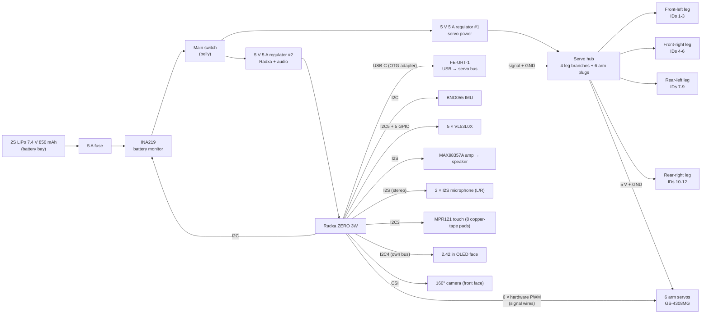

# Electronics design (hand-sized crab)

Every board lives inside the body. Parts and prices are in [BOM.md](BOM.md), the wiring
drawing is [wiring.svg](wiring.svg) (made by `python hardware/wiring_diagram.py`), and the numbers
below come from the simulator (`python sim/power.py`, `python sim/check.py`).

Where things sit (see the CAD, `cad/parts.py`):

| Place | What |
|---|---|
| **Battery bay** (under the servo deck, across the body, belly door) | 2S LiPo up to 57.5 × 30.5 × 18 mm (Bonka 850 mAh) |
| **Deck** (between the six yaw servos) | FE-URT-1 bus adapter, servo hub (12 bus + 6 arm headers), fuse, BNO055 IMU (foam tape) |
| **Under the brain tray** (taped to its underside) | Two 5 V 5 A regulators, INA219 battery monitor |
| **Belly** | Main power switch (behind the battery door) |
| **Brain tray** (under the dome, lifts out) | Radxa ZERO 3W, MAX98357A amp, two I2S microphones (left + right), MPR121 touch board |
| **Front wall** (between the arms) | 160° wide-angle camera behind the lens hole |
| **Face visor** (front of the dome) | 2.42" 128×64 OLED face (SSD1309), slid in from inside the dome |
| **Inside the dome** | 28 mm speaker in its seat under the grille; copper-tape touch pads (head, back left/right, sides, face bezel) wired to the MPR121 |
| **Chassis walls** | Five VL53L0X cliff sensors behind angled windows: front pair, rear, both sides (decision 30) |

## Block diagram

## Why it's built this way

- **Servo voltage: 5 V, regulated.** A full 2S LiPo is **8.4 V**, more than any of these servos take
  (STS3032: rated 4.8–6 V; GS-4308MG: 4.8–6 V), so they run from a regulator. We use a **fixed 5 V / 5 A**
  buck (7Semi AP64500): compact, in stock, nothing to adjust wrongly. The simulator scales every
  servo's datasheet numbers to 5 V (`crab/params.py`). A second, identical regulator powers the Radxa.
- **Power doesn't go through the signal adapter.** The FE-URT-1 only converts the signal. Servo
  power goes from the regulator into the bus hub.
- **Short branches.** Each leg is its own branch from the hub (3 servos), and each arm servo has its
  own plug on the hub, so no connector carries more than about 1 A even when walking.
- **Arm servos straight on the Radxa's PWM pins.** The tiny arm servos are ordinary hobby servos:
  they take a pulse every 20 ms (1000–2000 µs) and can't report anything back. The Radxa ZERO 3W has
  six independent hardware PWM outputs on its header that don't clash with the audio, I2C or GPIO pins
  we use. So each arm servo's signal wire goes straight to one of them; its power and ground come from
  the hub. No extra board (a PCA9685 board would also work, and `robot/backends.py` supports one, but
  it would not fit in the body). Hardware PWM means exact pulses with no jitter.
- **The Radxa has its own 5 V regulator,** so servo current spikes can't brown it out and reset it.
  It's fed through the header's 5 V pins, which leaves both USB-C ports free (one for the FE-URT-1).
- **Fuse first.** The fuse sits directly after the battery, so the switch and every wire after it
  are protected.
- **A battery monitor, because the servos can't see the battery.** Behind the 5 V regulator the
  servos report a steady 5 V until the pack is nearly flat. An INA219 in the battery's + lead
  measures the real pack voltage (and current) over I2C. The software warns at 6.8 V (3.4 V per
  cell) and stops at 6.4 V (3.2 V per cell). The pet's mind also uses this as its "hunger".
- **One bus for the legs.** All 12 leg servos (STS3032, IDs 1–12) speak Feetech's STS protocol
  (4096 steps per turn) on one bus. `robot/feetech_bus.py` also speaks the older SCS protocol, so
  mixing in other Feetech servos later still works. Tested by `robot/selftest.py`.

## Power budget (simulated with each servo's datasheet model, robot mass 0.61 kg, 5 V bus)

| Activity | Servo current avg / peak | Battery current | Runtime, 850 mAh |
|---|---|---|---|
| Standing | 0.56 / 0.59 A | 1.0 A | ~40 min |
| Idle / wave emotes | 0.6–0.7 / 0.85 A | 1.0–1.1 A | ~36–39 min |
| Happy / angry dance | 0.7–0.8 / 1.1 A | 1.1–1.2 A | ~34–36 min |
| Crawl | 0.92 / 1.3 A | 1.3 A | ~32 min |
| Trot forward / sideways | 1.2 / 1.9 A | 1.5 A | ~27 min |

Assumptions: Radxa ZERO 3W (Wi-Fi on), camera and sensors at 4 W; regulators 90% efficient; 80% of the
pack is used. The 5 A regulator and fuse leave more than 2.5× headroom over the walking peaks, which
covers falls and short stalls. A desk pet mostly stands and idles, so expect about **35 minutes per
charge**. Numbers from `python sim/power.py`.

## Wiring table

| From | To | Wire / connector | Notes |
|---|---|---|---|
| Battery (XT30 / JST) | Fuse holder | 20 AWG silicone | Red = +, black = − |
| Fuse | INA219 VIN+ | 20 AWG | 5 A mini blade fuse |
| INA219 VIN− | Main switch | 20 AWG | The INA219 measures in the + lead only; GND goes straight through |
| INA219 VCC / GND / SDA / SCL | Radxa pins 1 / 9 / 3 / 5 (shared I2C) | 28 AWG | I2C address 0x40 |
| Switch | Regulator #1 VIN / GND | 20 AWG | |
| Switch | Regulator #2 VIN / GND | 22–24 AWG | |
| Regulator #1 VOUT / GND | Servo hub V+ / GND | 20 AWG | **Measure 4.9–5.2 V first, with nothing connected** |
| FE-URT-1 servo port | Servo bus hub signal + GND | Servo cable | Signal and GND only; the hub does not feed power back into the adapter |
| FE-URT-1 USB | Radxa's USB-C port (either) | USB-C OTG adapter + the FE-URT-1's USB cable | Shows up as `/dev/ttyUSB0`; 1 Mbps |
| Regulator #2 VOUT / GND | Radxa pin 2 (5 V) / pin 6 (GND) | 22 AWG soldered to the pads | Don't also power the Radxa through USB-C at the same time |
| Arm servo plugs (6) | Hub: V+ and GND from regulator #1; **signal** pin of each plug → Radxa header pin below | F-F jumper wires for the signals | Order of plugs = PWM output 0–5 (table below). Servo wires: brown/black = GND, red = 5 V, orange/white = signal |
| BNO055 | Radxa pin 1 (3.3 V), 3 (SDA), 5 (SCL), 9 (GND) | 28 AWG | I2C address 0x28 (bus `/dev/i2c-3`) |
| VL53L0X × 5 | Own bus I2C5-M0 (pins 29/31), 3.3 V and GND from pins 1/9; XSHUT: front left 11, front right 13, rear 15, side left 22, side right 36 | 28 AWG | All start at 0x29; the software wakes them one at a time with XSHUT and gives them 0x30-0x33 (the last keeps 0x29). Own bus: off the BNO055's (0x28/0x29) |
| MAX98357A | 5 V (pin 4), GND (pin 14), BCLK pin 12, LRC pin 35, DIN pin 40 | 28 AWG | Speaker on its + / − terminals. These are the Radxa's I2S3-M0 pins (same places as on a Pi) |
| I2S microphones ×2 (DFRobot) | both: 3.3 V (pin 17), GND (pin 20), SCK pin 12, WS pin 35, SD pin 38. **Left mic SEL → GND, right mic SEL → 3.3 V** | 28 AWG | One stereo stream (left/right) on one data line; sit them ~70 mm apart in the dome, under the two mic holes. The direction of your voice comes from the time difference |
| MPR121 touch | 3.3 V, GND, SDA pin 3, SCL pin 5 (shared I2C3), address 0x5A | 28 AWG | Electrodes E0–E7: head, back left, back right, side left, side right, face bezel, claw left, claw right. Each is a strip of copper tape inside the shell with a thin wire soldered to it |
| Face OLED (SSD1309) | 3.3 V, GND, SDA **pin 27**, SCL **pin 28** (I2C4, its own bus), address 0x3C | 28 AWG | Set the module to I2C first (move its two 0 Ω resistors to the I2C position, as printed on its back). Enable the I2C4-M0 overlay. Its other pins: RES to a 10 kΩ pull-up to 3.3 V with 100 nF to GND (a power-on reset pulse; the SSD1309 needs one), DC and CS to GND (DC low = address 0x3C) |
| Camera (160°, OV5647) | Radxa camera connector (22-pin, same as the Pi Zero's) | Its own flex | Behind the front-wall lens hole; the flex goes up through the slot to the tray. **Measure its lens board first: the pocket was sized for a slimmer camera** |

### Arm servo signals (Radxa hardware PWM)

| PWM output | Joint | Radxa header pin | PWM channel (rsetup overlay) |
|---|---|---|---|
| 0 | L_shoulder_yaw (left arm swing) | 16 | PWM8-M0 |
| 1 | L_shoulder_pitch (left arm lift) | 18 | PWM9-M0 |
| 2 | L_claw | 21 | PWM12-M1 |
| 3 | R_shoulder_yaw | 24 | PWM13-M1 |
| 4 | R_shoulder_pitch | 7 | PWM14-M0 |
| 5 | R_claw | 19 | PWM15-M1 |

Enable the six overlays in `sudo rsetup` → Overlays, then reboot. `python robot/run.py --check` lists any
output it can't find by its header pin.

Inside each leg the servos daisy-chain with the cables that come with them: hub → yaw → thigh → knee.
The arm servos don't chain: each has its own 150 mm lead back to its plug on the hub.

Each lead drops through the deck into the space above the battery. Nothing hangs outside except the
short loops that cross each joint.

## Servo ID map (matches `crab/params.py` JOINT_NAMES order)

| ID | Joint | Servo | ID | Joint | Servo |
|---|---|---|---|---|---|
| 1 | FL_coxa | STS3032 | 7 | RL_coxa | STS3032 |
| 2 | FL_femur | STS3032 | 8 | RL_femur | STS3032 |
| 3 | FL_tibia | STS3032 | 9 | RL_tibia | STS3032 |
| 4 | FR_coxa | STS3032 | 10 | RR_coxa | STS3032 |
| 5 | FR_femur | STS3032 | 11 | RR_femur | STS3032 |
| 6 | FR_tibia | STS3032 | 12 | RR_tibia | STS3032 |

IDs 13–18 are the arm servos in the software's joint list, but they have no bus ID: they are PWM
outputs 0–5 (table above).

New bus servos all ship as **ID 1**. `robot/setup_servo.py --id N` assigns IDs one servo at a time.
Put a small sticker with the ID on each servo.

## Servo settings written by the setup script

| Register | Value | Why |
|---|---|---|
| P / I / D gains | 32 / 0 / 0 | Feetech default stiffness; the simulator's position gains assume it |
| Max input voltage | 65 (6.5 V) | Above the 5 V bus, below the battery: the servos shut off if the regulator fails and passes the battery voltage (rated 4.8–6 V) |
| Min input voltage | 40 (4.0 V) | Stops before the bus sags too far |
| Return delay | 0 | Faster bus |

## Safety rules (read before first power-up)

1. **First power-up on a current-limited supply** if you have one: 7.4 V with the limit at 1 A.
   Otherwise, power up with **no servos connected**, then plug in one limb at a time.
2. **Check polarity with the multimeter** at every connector before plugging anything in.
3. Measure both 5 V regulators (**4.9–5.2 V**) with nothing connected.
4. Charge LiPos **only in the LiPo bag, in a fire-safe place, never unattended**. Use the balance
   charger (SkyRC E3; it charges 2S packs through the balance lead).
5. The software warns when the pack reaches 6.8 V and stops (torque off: leg servos released, arm
   PWM outputs switched off) below 6.4 V for more than 1 s. It also stops if the servo bus sags below
   4.6 V (`robot/crab_robot.py`). Charge before the next session. Never store a LiPo empty.
6. If a battery is **puffy, dented or hot**, stop using it and dispose of it at an e-waste point.
